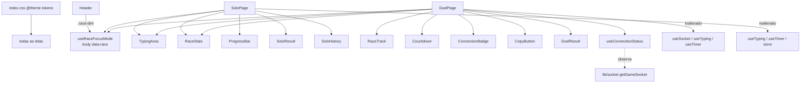

# Redesign UX/UI — Design

**Spec**: `.specs/features/ux-redesign/spec.md`
**Referência visual**: `.specs/front/index.figcraft`, `.specs/front/previews/*.png`
**Status**: Approved

---

## Architecture Overview

A lógica fica onde está. Páginas continuam donas do estado de partida e dos listeners de socket. A mudança é de apresentação: tokens no CSS, componentes visuais novos e dois hooks de UI novos (conexão e modo foco), que só observam e nunca mudam a lógica existente.

---

## Code Reuse Analysis

### Existing Components to Leverage

| Component | Location | How to Use |
| --- | --- | --- |
| `TypingArea` | `src/components/TypingArea.tsx` | Reescrever a apresentação; manter props `target`, `typed`, `onChange`, `disabled`, `autoFocus` |
| `ProgressBar` | `src/components/ProgressBar.tsx` | Manter `role="progressbar"`; trocar `width` por `scaleX` e cores para tokens |
| `Countdown` | `src/components/Countdown.tsx` | Manter prop `value`; nova animação e região viva |
| `ConnectionBadge` | `src/components/ConnectionBadge.tsx` | Trocar `connected: boolean` por `status: ConnectionStatus` |
| `CopyButton` | `src/components/CopyButton.tsx` | Adicionar `copiedLabel`, `variant` e falha visível |
| `timeAgo` | `src/lib/format.ts` | Reusar no histórico |
| `calculateWpm` | `src/hooks/useSocket.ts` | Reusar, sem alterar |
| `useHistoryStore` | `src/store/playerStore.ts` | Leitura para média, recorde e barras; sem alterar o store |

### Integration Points

| System | Integration Method |
| --- | --- |
| Socket.IO | `useConnectionStatus(socket)` registra `connect`/`disconnect` no socket e `reconnect_attempt` no `socket.io` (Manager); remove os listeners no cleanup |
| React Router | `useSearchParams` para `?code=`; `navigate('/', { state: { redirectTo } })` |
| Google Fonts | `<link>` com `display=swap` e `preconnect` em `index.html` |

---

## Components

### Tokens (`src/index.css`)
- **Purpose**: Fonte única de cor, fonte, easing e utilitários globais.
- **Interfaces**: `@theme` com `--color-{bg,surface,surface-2,core,line,ink,muted,untyped,accent,on-accent,rival,error,ok}`, `--font-sans`, `--font-mono`, `--ease-brass: cubic-bezier(.32,.72,0,1)`. Classes globais: `.race-dim`, `.caret`, `.caret-idle`, `.countdown-pop`, `:focus-visible`, bloco `prefers-reduced-motion`.
- **Reuses**: o bloco de reduced-motion e o foco já existentes.

### `ui.ts` (`src/lib/ui.ts`)
- **Purpose**: Strings de classe compartilhadas para botões e superfícies, para não repetir 15 classes em cada página.
- **Interfaces**: `btnPrimary`, `btnSecondary`, `btnGhost`, `btnDanger`, `bezelOuter`, `bezelInner`.

### `Kbd` (`src/components/Kbd.tsx`)
- **Purpose**: Dica de tecla.
- **Interfaces**: `Kbd({ children, onAccent? })`; renderiza `<kbd>`.

### `TypingArea`
- **Purpose**: Palco de digitação.
- **Interfaces**: props atuais + `id?` para o botão "Reiniciar" vir logo depois no DOM.
- **Comportamento**: spans por caractere; caret como elemento absoluto posicionado por `transform` a partir do `offsetLeft/offsetTop` do span atual (medido em `useLayoutEffect`, escrita direta no DOM, sem `setState`); `isTyping` setado no `onChange` e limpo por timeout de 500 ms; `focused` por `onFocus`/`onBlur`; listener global de `keydown` só enquanto desfocado.

### `RaceStats` (`src/components/RaceStats.tsx`)
- **Interfaces**: `RaceStats({ remainingSec, wpm, accuracy })`.
- **Reuses**: substitui o trio de `StatPill`.

### `RaceTrack` (`src/components/RaceTrack.tsx`)
- **Interfaces**: `RaceTrack({ lanes: { name, tag?, progress, tone: 'accent'|'rival' }[] })`.

### `useConnectionStatus` (`src/hooks/useConnectionStatus.ts`)
- **Interfaces**: `useConnectionStatus(socket: Socket): ConnectionStatus` com `type ConnectionStatus = 'connected'|'connecting'|'reconnecting'|'offline'`.
- **Regra**: `offline` se o navegador está offline; senão `connected` se `socket.connected`; senão `reconnecting` se já conectou antes; senão `connecting`. Todo `setState` acontece em callbacks de evento.

### `useRaceFocusMode` (`src/hooks/useRaceFocusMode.ts`)
- **Interfaces**: `useRaceFocusMode(active: boolean): void`. Seta `document.body.dataset.race = 'running'` e remove no cleanup.

### `SoloResult`, `SoloHistory`, `DuelResult`
- **Purpose**: Cartões de resultado e histórico extraídos das páginas.
- **Interfaces**: `SoloResult({ wpm, accuracy, durationMs, correctChars, errors, difficulty, onReplay, onNewText, primaryRef })`; `SoloHistory()` lendo o store; `DuelResult({ ranking, me, onPlayAgain, onLeave, primaryRef })`.

---

## Data Models

Sem modelos novos. `ConnectionStatus` é o único tipo novo (acima). Erros de partida no resultado = `round(totalKeystrokes × (1 − accuracy/100))`, com valores já expostos por `useTyping`.

---

## Error Handling Strategy

| Error Scenario | Handling | User Impact |
| --- | --- | --- |
| Falha ao carregar texto | Mantém `setError`; card com título fixo + detalhe + "Tentar novamente" | Sabe o que houve e como seguir |
| Clipboard indisponível | `catch` mostra "Não foi possível copiar" | Pode copiar o link visível manualmente |
| Fontes não carregam | Fallback de sistema na pilha `--font-*` | Layout continua legível |
| Socket cai | Badge + banner via `useConnectionStatus` | Sabe que está reconectando |
| Oponente sai | Mensagem + "Voltar ao lobby" (`resetToLobby` existente) | Tem saída clara |

---

## Risks & Concerns

| Concern | Location (file:line) | Impact | Mitigation |
| --- | --- | --- | --- |
| Lint falha antes da feature (7 erros em hooks) | `src/hooks/useTyping.ts:51-73`, `src/hooks/useTimer.ts:30` | Gate de lint nunca fica verde | Override em `eslint.config.js` só para `src/hooks/**` (AD-001) |
| `setState` em efeito no fim do Solo | `src/pages/SoloPage.tsx:57`, `:80` | Erro de lint; render em cascata | `finished` derivado; efeito só faz efeitos externos com guarda por ref |
| `setState` em efeito no shake | `src/components/TypingArea.tsx:31` | Erro de lint | O shake é removido (TYPE-08) |
| `disconnectGameSocket` faz `removeAllListeners` no unmount | `src/lib/socket.ts:20` | Listeners do hook novo somem junto | Aceitável: o hook vive só dentro do DuelPage; cleanup é tolerante |
| Sem testes automatizados | projeto inteiro | Regressões não são pegas por suíte | Verifier faz checagem por leitura com `file:line`; AD-002 |
| `?code=` não chega ao Duel se não há nome | `src/pages/DuelPage.tsx:46-48` | Convite perde o código | `redirectTo` com path + search (HOME-05) |

---

## Tech Decisions

| Decision | Choice | Rationale |
| --- | --- | --- |
| Caret | Elemento único movido por `transform` | Desliza (motion aprovado) sem re-render por tecla além do atual |
| Modo foco no Header | Atributo no `body` + classe `.race-dim` | Header fica fora das rotas; evita store novo |
| Classes de botão | Constantes em `src/lib/ui.ts` | Padrão atual é classe inline; constantes evitam divergência sem criar abstração de componente |
| "Qualquer tecla para focar" | `keydown` global só enquanto desfocado | Não intercepta atalhos nem outros campos |
